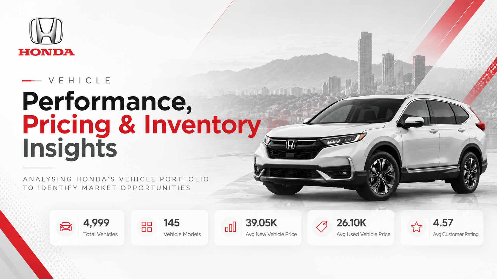
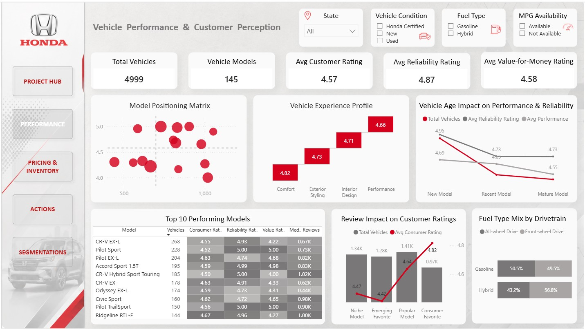
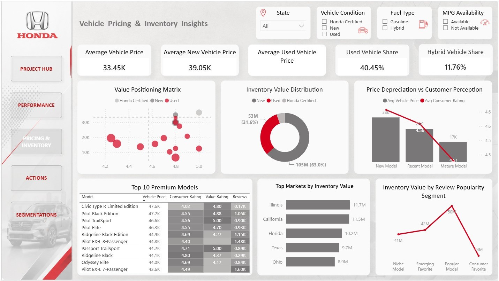
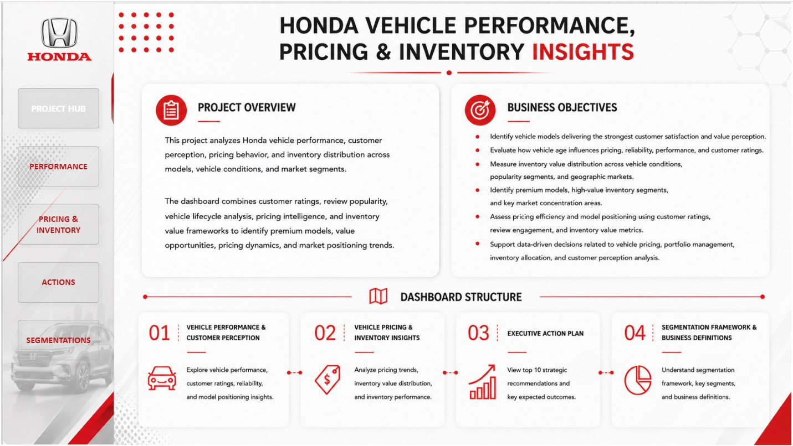
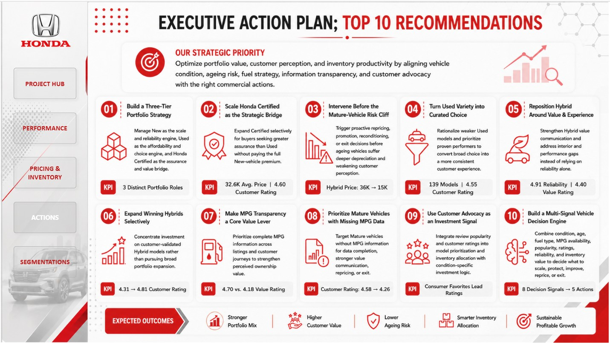
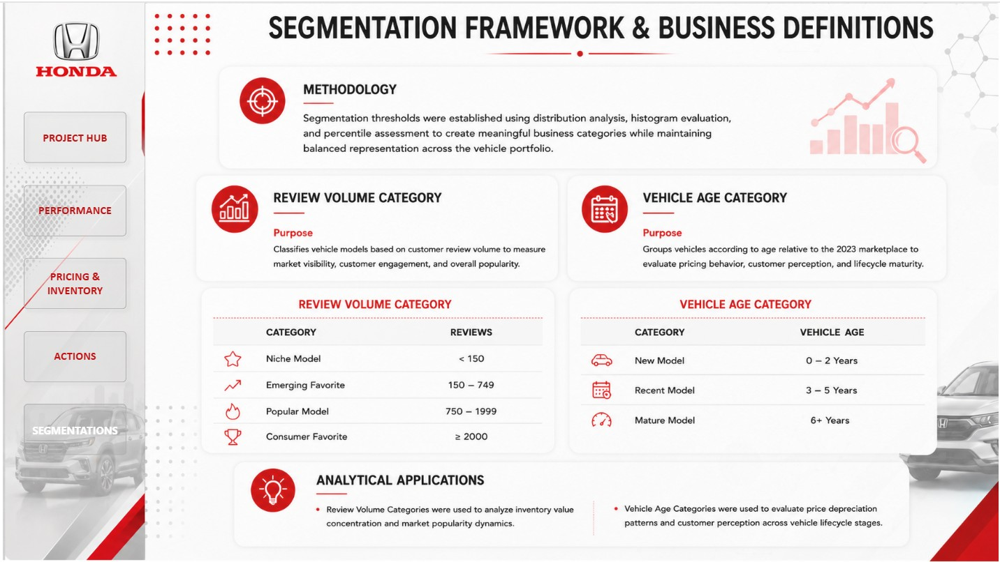

<div align="center">

# Honda Vehicle Performance, Pricing & Inventory Insights

**A Power BI portfolio project connecting vehicle performance, customer perception, pricing, depreciation, and inventory into one portfolio-level view.**



**Project Status: Completed**

[**Open the Live Power BI Dashboard →**](https://app.powerbi.com/view?r=eyJrIjoiYjljODdmNDQtYzU4My00ZmE1LTgxNzItODEyMWIyOThlMjJlIiwidCI6ImM2ZTU0OWIzLTVmNDUtNDAzMi1hYWU5LWQ0MjQ0ZGM1YjJjNCJ9&pageName=d4c69b133009d710cb45)

</div>

---

## Project Overview

This project analyzes **4,999 Honda vehicle records** to understand how vehicle performance, customer perception, pricing, vehicle lifecycle, and inventory characteristics connect across a vehicle portfolio.

It was created primarily as a **practical Power BI practice project** to strengthen skills in Power Query, DAX, segmentation, dashboard design, and business-oriented analysis, while also developing a portfolio-ready Data Analytics project.

The central analytical story is:

> **Performance → Perception → Pricing → Inventory → Strategic Action**

Rather than treating these dimensions as isolated KPIs, the analysis brings them together to support portfolio-level decisions.

## Business Question

> **How should Honda evaluate vehicle performance, customer perception, pricing, depreciation, and inventory as one connected portfolio problem?**

The analysis focuses on:

- Vehicle performance and customer perception
- Pricing and value positioning
- Inventory composition and value
- Customer advocacy and review engagement
- Portfolio-level strategic opportunities

## Dataset

| Attribute | Detail |
|---|---|
| **Domain** | Automotive |
| **Source** | Kaggle — Honda Data (`omartorres25`) |
| **Records** | **4,999** vehicle records |
| **Models** | **145** models represented in the final dashboard |
| **Granularity** | Vehicle-level records |
| **Primary Tool** | Power BI |
| **Data Preparation** | Power Query |
| **Core Segmentation** | Vehicle Age & Review Volume |

**Source:** [Honda Data — Kaggle](https://www.kaggle.com/datasets/omartorres25/honda-data)

> **Publication note:** The original source CSV is not redistributed at this stage because its current redistribution terms need to be verified. Fields such as VIN and Stock Number should not be published unnecessarily.

## Tools & Technologies

- **Power BI** — data modeling, DAX, interactive analysis and dashboarding
- **Power Query** — data preparation, transformation, typing and standardization
- **DAX** — KPI measures, analytical calculations and segmentation logic
- **Git / GitHub** — version control, documentation and portfolio publication

## Analytical Workflow

The project was developed through an analytical workflow rather than beginning with dashboard construction.

```text
Raw Data
   ↓
Power Query Preparation
   ↓
Column-Level Exploration
   ↓
Segmentation Design
   ↓
Business Analysis
   ↓
Insight Development
   ↓
Strategic Recommendations
   ↓
Power BI Dashboard
```

### Why segmentation came before the main analysis

Vehicle Age and Review Volume were defined after exploring distributions and considering business interpretability. These segments were then used throughout the analysis.

The segmentation page in the report is therefore a **stakeholder reference page**, not the point at which segmentation was created.

For the detailed methodology, see [Analytical Approach](docs/analytical-approach.md).

## Data Preparation

The raw Honda dataset was prepared in Power Query before the analytical model was built.

Key transformations included:

- Promoting the source headers
- Removing `$` from `Price`
- Converting `Not Priced` entries in `Price` to `0`
- Removing comma separators from `Price`
- Applying appropriate data types
- Renaming `Consumer_Review_#` to `Consumer_Review`
- Removing unnecessary fields
- Standardizing problematic `State` values
- Applying the existing row-filter steps in the query

Fields removed:

- `VIN`
- `Stock_#`
- `Exterior_Color`
- `Interior_Color`

Blank or inconsistent `State` values, including values such as `Glens`, `Route`, and `MO-22`, were standardized to `unknown`.

## Analytical Framework

### Vehicle Age

| Segment | Definition |
|---|---:|
| **New Model** | 0–2 years |
| **Recent Model** | 3–5 years |
| **Mature Model** | 6+ years |

### Review Volume

| Segment | Definition |
|---|---:|
| **Niche Model** | <150 reviews |
| **Emerging Favorite** | 150–749 reviews |
| **Popular Model** | 750–1,999 reviews |
| **Consumer Favorite** | ≥2,000 reviews |

These definitions were established using distribution analysis, histogram evaluation, percentile assessment and business interpretability.

See [Segmentation Framework](docs/segmentation-framework.md) for the detailed definitions and rationale.

## What the Analysis Examines

### 01 — Performance & Customer Perception

The performance analysis combines customer ratings, reliability, value-for-money, comfort, interior design, exterior styling, performance, review volume, model positioning and vehicle age.

The emphasis is on understanding which models combine **customer perception, performance and meaningful market presence**.

### 02 — Pricing & Value

The pricing analysis examines average vehicle price, new vs used pricing, price depreciation, vehicle age, price positioning, premium models and value-oriented segments.

### 03 — Inventory Intelligence

Inventory is evaluated through inventory value, vehicle age, condition, fuel type, drivetrain, review-popularity segments, seller and ownership characteristics, geographic markets and model concentration.

### 04 — Customer Advocacy

Review volume is treated as an additional signal for understanding **consumer attention and model positioning**, rather than as a standalone popularity ranking.

### 05 — Portfolio Opportunities

The final strategic question is:

> **Which parts of the portfolio should be protected, scaled, repositioned, selectively expanded, or investigated further?**

## Power BI Dashboard

The published report contains five stakeholder-facing pages plus supporting tooltip pages. The README highlights the two core analytical pages first, followed by the complete dashboard gallery.

### 01 — Vehicle Performance & Customer Perception

The first core dashboard brings together model positioning, vehicle experience, lifecycle effects, customer ratings, review engagement and drivetrain mix.

It establishes the **performance and perception** side of the portfolio story.



### 02 — Vehicle Pricing & Inventory Insights

The second core dashboard connects price positioning, new-vs-used value, inventory value, depreciation, premium models, geographic inventory concentration and review-popularity segments.

It establishes the **pricing and inventory** side of the portfolio story.



### Complete Dashboard Gallery

The repository also includes the supporting stakeholder pages used in the final report:

<details>
<summary><strong>Project Hub</strong></summary>



</details>

<details>
<summary><strong>Executive Action Plan</strong></summary>



</details>

<details>
<summary><strong>Segmentation Framework & Business Definitions</strong></summary>



</details>

## Key Portfolio Signals

| Metric | Signal |
|---|---:|
| **Total Vehicles** | **4,999** |
| **Vehicle Models** | **145** |
| **Average Customer Rating** | **4.57** |
| **Average Reliability Rating** | **4.87** |
| **Average Value-for-Money Rating** | **4.58** |
| **Average Vehicle Price** | **33.45K** |
| **Average New Vehicle Price** | **39.05K** |
| **Average Used Vehicle Price** | **26.10K** |
| **Used Vehicle Share** | **40.45%** |
| **Hybrid Vehicle Share** | **11.76%** |

## Executive Action Plan

The analysis was translated into ten portfolio-level recommendations:

1. **Three-Tier Portfolio Strategy**
2. **Scale Honda Certified as the Strategic Bridge**
3. **Intervene Before the Mature-Vehicle Risk Cliff**
4. **Turn Used Variety into Curated Choice**
5. **Reposition Hybrid Around Value & Experience**
6. **Expand Winning Hybrids Selectively**
7. **Make MPG Transparency a Core Value Lever**
8. **Prioritize Mature Vehicles with Missing MPG Data**
9. **Use Customer Advocacy as an Investment Signal**
10. **Build a Multi-Signal Vehicle Decision Engine**

The complete executive artifact is available as [Honda Executive Insights & Action Plan](reports/Honda_Executive_Insights_Action_Plan.pdf), while the underlying recommendation logic is documented in [Strategic Recommendations](docs/recommendations.md).

## Project Reports

Two presentation-ready PDF artifacts are included in the repository:

- [Full Project Report — Dashboard & Analysis](reports/Honda_Vehicle_Performance_Pricing_Inventory_Insights.pdf)
- [Executive Insights & Action Plan](reports/Honda_Executive_Insights_Action_Plan.pdf)

These provide a recruiter- and stakeholder-friendly way to review the project without opening Power BI Desktop.

## Project Documentation

The repository includes supporting documentation for anyone who wants to go beyond the dashboard:

- [Analytical Approach](docs/analytical-approach.md) — preparation, exploration, segmentation and analytical workflow
- [Segmentation Framework](docs/segmentation-framework.md) — business definitions and thresholds
- [Strategic Recommendations](docs/recommendations.md) — recommendation logic and portfolio actions
- [DAX Calculations](docs/dax-calculations.md) — measures, calculated logic and DAX documentation

## Repository Structure

```text
honda-vehicle-performance-and-inventory-insights/
│
├── README.md
├── .gitignore
├── REPOSITORY_NOTES.md
│
├── Images/
│   ├── 00_title_card.png
│   ├── 00_project_hub.jpg
│   ├── 01_performance.jpg
│   ├── 02_pricing_inventory.jpg
│   ├── 03_actions.jpg
│   └── 04_segmentations.jpg
│
├── reports/
│   ├── Honda_Vehicle_Performance_Pricing_Inventory_Insights.pdf
│   └── Honda_Executive_Insights_Action_Plan.pdf
│
├── data/
│   └── README.md
│
├── powerbi/
│   ├── Honda_Vehicle_Performance_Analysis.pbix
│   └── README.md
│
└── docs/
    ├── analytical-approach.md
    ├── segmentation-framework.md
    ├── recommendations.md
    └── dax-calculations.md
```

## Author

**Debanjan Biswas**  
Data Analyst    Excel | Power BI | SQL | Python  
**Email:** [bishwasdebanjan99@gmail.com](mailto:bishwasdebanjan99@gmail.com)

This project was developed as a practical exercise to strengthen Power BI and Data Analytics skills, with the goal of turning hands-on learning into a professional portfolio project.

---

## Project Perspective

The purpose of this project was to move beyond a conventional vehicle dashboard.

The analysis connects **performance, customer perception, pricing, vehicle lifecycle, and inventory** into one portfolio-level view.

The resulting decision chain is:

> **Understand the portfolio → identify where value is created or exposed → determine which signals matter → translate evidence into action.**

